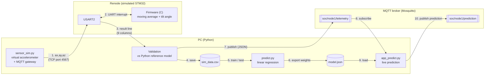

# renode_simulation_stm32_iot_prediction

Virtual IoT SoC: C firmware (STM32, HAL) simulated in Renode, with a Python virtual accelerometer over a UART/TCP socket, moving-average filtering, tilt-angle computation and linear-regression prediction (scikit-learn).

An optional MQTT layer publishes the node's telemetry through a broker and runs the trained model as a live subscriber application.

> Course project (SOC course, mini-project 6: virtual IoT SoC with intelligent prediction). Everything here runs in simulation. No physical board is used.

## Table of contents

1. [What the project does](#1-what-the-project-does)
2. [Architecture](#2-architecture)
3. [Data contract](#3-data-contract)
4. [Repository layout](#4-repository-layout)
5. [Requirements and installation](#5-requirements-and-installation)
6. [How to run and test the project](#6-how-to-run-and-test-the-project)
7. [How it works in detail](#7-how-it-works-in-detail)
8. [Output files](#8-output-files)
9. [Troubleshooting](#9-troubleshooting)
10. [Limitations](#10-limitations)

---

## 1. What the project does

The goal is to reproduce, entirely on a PC, the chain of a small IoT sensor node:

1. A **virtual accelerometer** (Python) produces acceleration samples `ax, ay, az` at 50 Hz.
2. A **virtual microcontroller** (an STM32 simulated by Renode) runs real C firmware. It receives the samples on its UART, filters them with a moving average, computes the tilt angle (pitch) and sends everything back.
3. A **regression model** (scikit-learn) learns to predict the pitch angle 100 ms ahead from the last 5 angles.
4. An optional **MQTT layer** carries the telemetry to an application that uses the trained model in real time.

The firmware that runs in the simulator is built from the same C code as a real board would use (HAL, UART interrupt, `main.c` generated with STM32CubeMX). Only the sensor and the host side are simulated.

## 2. Architecture



Notes on the roles:

- In the simulation, one Python process (`sensor_sim.py`) is both the virtual sensor and the gateway. Renode's socket terminal serves one client, so the process that reads the UART is the one that publishes to MQTT.
- On real hardware, the equivalent chain would be: MPU sensor -> I2C -> STM32 -> UART -> network module (for example an ESP32) -> MQTT broker -> application. That hardware part is not implemented in this repository.

## 3. Data contract

All values are integers. No floating point is exchanged.

| Quantity | Unit |
|---|---|
| Acceleration (`ax`, `ay`, `az`) | mg (1000 mg is about 1 g) |
| Angle (`pitch`) | centi-degrees (hundredths of a degree, 4500 = 45.00 degrees) |

**PC to board** (one line per sample):

```
ax,ay,az\n
```

**Board to PC** (one line per sample, nine comma-separated integers):

```
t_ms,ax,ay,az,fax,fay,faz,pitch_raw,pitch_filt
```

- `t_ms`: firmware tick (`HAL_GetTick()`) when the answer was produced.
- `fax, fay, faz`: moving-average filtered accelerations.
- `pitch_raw`: angle computed from the raw `ax, az`.
- `pitch_filt`: angle computed from the filtered `fax, faz`.

**Special lines**:

- The firmware sends `READY` once at boot.
- Lines starting with `#` are comments or errors and are ignored by the Python side.

**MQTT messages** (JSON):

| Topic | Payload |
|---|---|
| `soc/node1/telemetry` | `{"t_ms", "ax", "ay", "az", "pitch_raw", "pitch_filt"}` |
| `soc/node1/prediction` | `{"t_ms", "pitch_pred_100ms"}` |

## 4. Repository layout

```
.
├── Filter_Core/     Filter_Core.c, Filter_Core.h   hardware-independent filter and pitch code
├── firmware_sim/    STM32CubeIDE project (STM32F407, HAL), built to an .elf for Renode
├── sim/             run.resc (Renode script), sensor_sim.py, predict.py, app_predict.py,
│                    client_test.py, sim_data.csv, resultats_s7.png
├── tests/           test_core.c, ref_model.py   core validation on the PC
├── firmware_real/   empty for now
├── data/            empty for now
├── analysis/        empty for now
└── report/          empty for now
```

The `Filter_Core` code has no hardware dependency: the same functions are used by the PC test and by the firmware (included as `Filter_Core.h` in `main.c`).

The Python scripts of the simulation are all in `sim/` and use relative file names (`sim_data.csv`, `model.json`): run them from that folder.

## 5. Requirements and installation

Environment used for development: Ubuntu 24.04, Renode 1.17.0 (linux-portable), Python 3.12, gcc.

| Tool | Used for |
|---|---|
| Renode | simulate the STM32 board |
| STM32CubeIDE / CubeMX | generate and build the firmware (HAL) |
| gcc | build the core test on the PC |
| Python 3 | virtual sensor, evaluation, application |
| Mosquitto | MQTT broker (optional layer) |

**Renode**: download the release for your system from https://github.com/renode/renode/releases/latest and follow its README. The release page lists a `dotnet` requirement; check it against your installed version. Put the folder in your `PATH` so that `renode` starts from any terminal.

**System packages** (Ubuntu):

```bash
sudo apt install build-essential python3 python3-venv mosquitto mosquitto-clients
```

**Python environment**:

```bash
python3 -m venv ~/venv_soc
source ~/venv_soc/bin/activate
pip install numpy pandas scikit-learn matplotlib paho-mqtt
```

`app_predict.py` and `sensor_sim.py` use the paho-mqtt 2.x API (`mqtt.CallbackAPIVersion.VERSION2`). If you get an `AttributeError` on it, run `pip install -U paho-mqtt`.

Activate the environment in every new terminal before running a Python script: `source ~/venv_soc/bin/activate`.

## 6. How to run and test the project

The tests go from the simplest to the most complete. Do not move to the next level until the expected result is reached.

### Level 1: the C core on the PC

From the `tests/` folder:

```bash
gcc -Wall -Wextra -o test_core ../Filter_Core/Filter_Core.c ./test_core.c -lm
python3 ref_model.py
```

`-lm` must stay at the end of the command (it links the math library used by `atan2f`).

What it does: Python generates 1000 random `(ax, az)` pairs (fixed seed 42, values in [-1000, 1000]), sends them to `test_core`, recomputes everything with a Python reference model and compares the results.

Expected output:

```
Lignes comparées        : 1000
Moyenne glissante fausse: 0
Angles différents       : 0
Écart max sur l'angle   : 0 centi-degré
OK
```

The moving average must be exactly identical. A difference of 0 or 1 centi-degree on the angle is acceptable (float 32-bit in C against 64-bit in Python), above that is a bug.

Run it from the folder that contains `test_core`: the script launches `./test_core` with a relative path.

### Level 2: firmware in Renode with the virtual sensor

1. Build the firmware in STM32CubeIDE (`firmware_sim/`) to get the `.elf` file in `firmware_sim/Debug/`. Rebuild it every time `main.c` or the core changes.
2. From the **project root**, start Renode with the simulation script:

   ```bash
   cd Mini-Projet-SoC
   renode sim/run.resc
   ```

   `sim/run.resc` contains:

   ```
   mach create "SoC"
   machine LoadPlatformDescription @platforms/boards/stm32f4_discovery-kit.repl
   emulation CreateServerSocketTerminal 4567 "term" false
   connector Connect sysbus.usart2 term
   sysbus LoadELF @firmware_sim/Debug/firmware_sim.elf
   ```

   It creates the virtual STM32F4 Discovery machine, opens a TCP server socket on port 4567 (last argument `false`: no Telnet configuration bytes, so the stream is raw UART data), connects it to USART2, and loads the firmware. The path of the `.elf` is relative to the folder where Renode is launched, which is why Renode must be started from the project root. The script does not start the simulation: this is done by hand in step 4, after the Python script has connected.
3. In another terminal (virtual environment active), from `sim/`:

   ```bash
   python3 sensor_sim.py
   ```

   The script connects to port 4567 and waits for the `READY` line.
4. In the Renode monitor, start the simulation:

   ```
   start
   ```

   The firmware boots, sends `READY`, and the exchange begins.

Expected output of `sensor_sim.py`:

```
READY reçu
publié 0
publié 50
...
500 échantillons, 0 écarts, erreur max d'angle = 0 centi-deg
sim_data.csv écrit
```

The "max angle error" must be 0 or 1. `0 écarts` means that for the 500 samples, the answers of the firmware match the Python model (filtered values and both angles).

The MQTT broker must be running during this step, because `sensor_sim.py` connects to it at startup (`systemctl status mosquitto`).

**Important**: quit and restart Renode before every new run of `sensor_sim.py`. The firmware sends `READY` only at boot, and its filters keep the previous values, so a second run on the same Renode session starts from a non-empty filter state.

### Level 2b: quick smoke test with a single sample (optional)

`sim/client_test.py` is a minimal client that checks the UART exchange without running the whole sensor simulation. It connects to port 4567, waits for `READY`, sends one line (`0,0,1000`) and prints the answer.

Same procedure as level 2 (start Renode from the project root, run the script, then type `start`), with `python3 client_test.py` in place of `sensor_sim.py`.

Expected: a single line `recu: <t>,0,0,1000,0,0,1000,0,0`. With `ax = 0` and `az = 1000` the angle is 0, and since it is the first sample after boot the filtered values equal the raw ones. Only `<t>` (the firmware tick) varies. As for level 2, restart Renode before each run.

### Level 3: evaluate the prediction model

From `sim/` (where `sim_data.csv` is):

```bash
python3 predict.py
```

Expected output: for the two inputs (raw angles and filtered angles), the learned weights and bias, the line `model.json écrit`, a table with MAE and RMSE for the naive baseline and for the regression, and `resultats_s7.png écrit`.

Check that `model.json` and `resultats_s7.png` exist in the folder. Read the table: the regression is useful only if its error is lower than the naive baseline (repeat the last known angle). If it is not, say so in the report.

### Level 4: MQTT telemetry without the application

Use three terminals.

**Terminal A (listener)**:

```bash
mosquitto_sub -v -t 'soc/#'
```

**Terminal B**: restart Renode (as in level 2), then run `python3 sensor_sim.py` and `start` in the Renode monitor.

Expected in terminal A: about 10 seconds of lines like

```
soc/node1/telemetry {"t_ms": 240, "ax": 312, "ay": -4, "az": 951, "pitch_raw": 1812, "pitch_filt": 1790}
```

one every 20 ms (the script pauses 20 ms between samples to simulate 50 Hz).

### Level 5: full chain with the live prediction application

1. Terminal A: `mosquitto_sub -v -t 'soc/#'` (optional, to watch the messages).
2. Terminal B, from `sim/`: `python3 app_predict.py`. Expected: `modèle chargé : [...]` then a connection message.
3. Terminal C: restart Renode, run `python3 sensor_sim.py`, then `start`.

Expected:

- In terminal A, `soc/node1/telemetry` lines mixed with `soc/node1/prediction {"t_ms": ..., "pitch_pred_100ms": ...}` lines. Predictions start at `t_ms = 80`, when the window holds 5 values.
- In terminal B, one line every 500 ms with the current angle, the predicted angle and a running error.

`app_predict.py` needs `model.json` in the folder it is run from (written by `predict.py`, level 3).

## 7. How it works in detail

### 7.1 Core (`Filter_Core.c`, `Filter_Core.h`)

Written in plain C with fixed-size integer types (`int32_t`) and no hardware dependency.

- `ma_t` is the state of one moving-average filter: a circular buffer of `MA_WIN` (5) values, the running sum, the write index and the number of stored values.
- `ma_init(&f)` clears the state.
- `ma_update(&f, x)` stores the new value, drops the oldest one when the buffer is full, updates the sum and returns `sum / n` (integer division, truncated toward zero). Using the running sum avoids adding all 5 values every time, and using `n` gives a correct average during the first samples while the buffer is filling.
- `pitch_cdeg(ax_mg, az_mg)` returns the angle in centi-degrees:

  ```c
  (int32_t)(atan2f((float)ax_mg, (float)az_mg) * 5729.578f)
  ```

  `atan2f` gives radians (with the right quadrant and no division by zero), and 1 rad = 5729.578 centi-degrees (180/pi x 100). The cast truncates toward zero. The angle is a simplified pitch from `ax` and `az` only.

The inputs and outputs are signed (`int32_t`). Using unsigned types here is a real bug: a negative `az` becomes a huge positive number and the angle collapses to 0.

### 7.2 Firmware (`main.c`, STM32 HAL)

- Clock configuration and USART2 at 115200 baud, 8N1, generated by CubeMX.
- At boot it initialises the three filters (`ax`, `ay`, `az`), sends `READY\n`, and arms a one-byte interrupt reception (`HAL_UART_Receive_IT`).
- `HAL_UART_RxCpltCallback` is called for each received byte. It appends the byte to a line buffer (ignoring `\r`), and on `\n` it terminates the string and raises a `line_ready` flag. It then re-arms the reception.
- The main loop waits for `line_ready`, parses the line with `sscanf("%d,%d,%d")`, runs the three filters, computes both angles with `pitch_cdeg`, and sends the nine-field answer with `snprintf` and `HAL_UART_Transmit`.
- A line that does not contain exactly three integers is ignored.

Variables shared between the interrupt and the main loop (`line_ready` and the receive byte) must be declared `volatile`, otherwise an optimising compiler may keep them in a register and the main loop never sees the change.

### 7.3 Simulated platform (Renode)

Renode loads the firmware `.elf` (built for an STM32F407) on a virtual STM32F4 Discovery board (`platforms/boards/stm32f4_discovery-kit.repl`). The virtual USART2 is connected to a TCP server socket on port 4567, so a normal Python socket acts like a serial cable to the board. The binary is the same one that would be flashed to the real chip.

### 7.4 Virtual sensor (`sensor_sim.py`)

- Generates `N = 500` samples at `FS = 50` Hz (10 seconds). The tilt angle is a sum of two sinusoids, `30 sin(2 pi 0.2 t) + 10 sin(2 pi 0.7 t)` degrees. From it: `ax = 1000 sin(theta)`, `az = 1000 cos(theta)` plus Gaussian noise (standard deviation 15 mg), and `ay` as pure noise. Values are rounded to integers in mg. The random seed is fixed (42), so every run generates the same samples.
- The exchange is **step by step**: send one line, wait for the answer line, then send the next. This avoids overflowing the UART reception of the simulated microcontroller.
- For every answer, the script recomputes the expected values with its own Python moving average (same truncation as C) and angle function, and checks the nine fields. A sample is correct if the raw and filtered accelerations match exactly and both angles are within 1 centi-degree.
- It writes `sim_data.csv` (the timestamp column is the nominal time `i x 20 ms`) and publishes each valid sample on MQTT.

### 7.5 Evaluation (`predict.py`)

- **Task**: from the last 5 angles, predict the angle 5 samples later (5 x 20 ms = 100 ms).
- **Windows**: for each position `i`, the input is the 5 angles ending at `i`, and the target is the angle at `i + 5`.
- **Two inputs, same target**: raw angles (`pitch_raw`) and filtered angles (`pitch_filt`). The target is always the filtered angle, so the two errors are comparable and only the input changes.
- **Split**: chronological, first 70 % for training, last 30 % for testing. Samples are not shuffled, otherwise the model would see the future.
- **Model**: `LinearRegression`, i.e. `angle_future = a1 x angle1 + ... + a5 x angle5 + b`. The whole model is six numbers.
- **Metrics**: MAE (mean absolute error) and RMSE (root mean square error, which penalises large errors more), in centi-degrees and in degrees.
- **Baseline**: the naive prediction "the angle in 100 ms equals the last known angle". A model that does not beat it brings nothing.
- **Export**: the weights and bias of the filtered-input model are saved to `model.json`.
- **Plot**: `resultats_s7.png` shows the target, the naive prediction and the regression on the test part.

"Filtered angle" means the angle computed from the filtered accelerations (`atan2(fax, faz)`), not a filter applied to the angle itself. The 5-value filter also delays the signal slightly (about 2 samples, 40 ms), so the model predicts the smoothed future signal, not the noisy one.

### 7.6 MQTT layer

MQTT is publish/subscribe: a sender publishes messages on a topic to a broker, and any client subscribed to that topic receives them. Sender and receiver never talk to each other directly.

- `sensor_sim.py` publishes each sample on `soc/node1/telemetry`.
- `app_predict.py` subscribes to it, keeps the last 5 filtered angles in a sliding window, and as soon as the window is full applies the model (a dot product of the 5 weights and the angles plus the bias, read from `model.json`). It publishes the result on `soc/node1/prediction`.
- It also keeps each prediction for 5 samples and compares it with the angle actually received then, to print a running error. This is only a demonstration of the data flow.

Training and use are separate: `predict.py` trains and evaluates offline, `app_predict.py` only applies the trained model.

## 8. Output files

| File | Written by | Content |
|---|---|---|
| `sim_data.csv` | `sensor_sim.py` | 500 samples: `t_ms, ax, ay, az, fax, fay, faz, pitch_raw, pitch_filt` |
| `model.json` | `predict.py` | weights and bias of the filtered-input model |
| `resultats_s7.png` | `predict.py` | test-part plot: target, naive baseline, regression |

`sensor_sim.py` overwrites `sim_data.csv` on every run.

## 9. Troubleshooting

| Symptom | Likely cause |
|---|---|
| `sensor_sim.py` blocks before `READY reçu` | Simulation not started (`start`), port 4567 not open, or Renode not restarted since the previous run (`READY` is sent only at boot) |
| `ConnectionRefusedError` | Either Renode is not listening on 4567, or the MQTT broker is not running on 1883 (the message gives the address) |
| `AttributeError ... CallbackAPIVersion` | Old paho-mqtt: `pip install -U paho-mqtt` |
| Differences on the first samples | Renode not restarted, filters already filled |
| Angle always 0 when `az` is negative | Unsigned types in the core (`uint32_t`): use `int32_t` |
| `undefined reference to atan2f` | `-lm` missing, or not at the end of the gcc command |
| `undefined reference to main` | Core compiled alone as a program: it needs `test_core.c` |
| `Permission denied: ./test_core.c` | The script must run `./test_core` (the executable), not the source file |
| `FileNotFoundError: model.json` | Run `predict.py` first, and run `app_predict.py` from the same folder |
| Nothing shown by `mosquitto_sub` | Broker stopped, or the producer is not publishing; test with `mosquitto_pub -t soc/test -m hello` |
| Renode crashes with `No space left on device` | Disk full: Renode must write its config under `~/.config/renode` |
| Renode cannot load the `.elf` | Renode was not started from the project root (the path in `sim/run.resc` is relative), or the firmware has not been built yet (`firmware_sim/Debug/firmware_sim.elf`) |

## 10. Limitations

- Simulation only. The sensor is synthetic (two sinusoids plus noise) and no real MPU or physical STM32 board is used. The folders `firmware_real/`, `data/`, `analysis/` and `report/` are empty placeholders: no real-board work is included.
- The gateway is a Python script on the PC. A real node would need a network module (Wi-Fi, BLE, LoRa) or an Ethernet-capable microcontroller.
- The live application is evaluated on the same synthetic signal the model was trained on. The error it prints demonstrates the data flow, it is not a valid evaluation. The figures to report are the ones from `predict.py` (test part only).
- The linear regression is deliberately simple. On a slow, smooth motion the naive baseline is already close, and a small gain is a normal result.
- The pitch uses only `ax` and `az` (`atan2(ax, az)`). It is correct for a rotation around one axis and is a simplification otherwise.
- The firmware parses text lines and uses an interrupt that reads one byte at a time; this is simple and sufficient for 50 Hz at 115200 baud, but it is not a robust protocol (no checksum, no framing beyond the newline).
