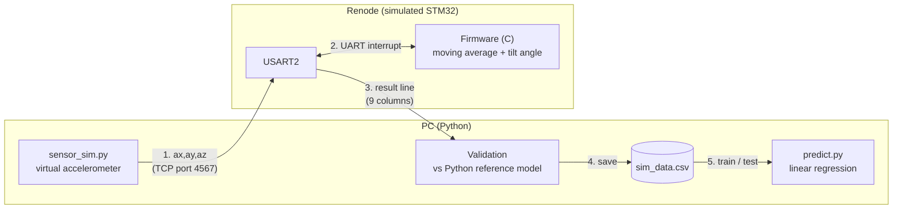

# Renode STM32 IoT Prediction

Virtual IoT SoC: C firmware (STM32, HAL) simulated in [Renode](https://renode.io), fed by a Python virtual accelerometer over a UART/TCP socket. The firmware filters the data and computes a tilt angle; a linear regression then predicts the angle 100 ms ahead.


## How it works



Steps 1 to 3 are repeated for each sample: the PC sends one line, waits for the reply, then sends the next.

1. `sim/sensor_sim.py` generates accelerometer samples (tilt motion + Gaussian noise, 50 Hz) and sends one line per sample.
2. The firmware reads each line (UART receive interrupt), applies a 5-sample moving average per axis, computes the tilt angle `atan2(ax, az)`, and replies.
3. Python checks every reply against an independent reference model and saves the data to `sim_data.csv`.
4. `sim/predict.py` trains a linear regression on the last 5 angles to predict the angle 5 samples (100 ms) later.

The processing code (`soc_core/`) has no hardware dependency, so the same source is meant to be reused on the real board.

## Data format

Integers only, no floats on the wire. Accelerations in mg, angles in centi-degrees.

| Direction | Line |
|---|---|
| PC to board (simulation) | `ax,ay,az\n` |
| Board to PC | `t_ms,ax,ay,az,fax,fay,faz,pitch_raw,pitch_filt\n` (`f` columns are filtered) |

Lines starting with `#` are comments or errors and are ignored by Python. The firmware sends `READY` at startup; the PC must wait for it before sending.

## Repository layout

```
soc_core/        Hardware-independent C core: moving average + angle
firmware_sim/    STM32CubeIDE project used for the Renode simulation
tests/           PC test of the core against a Python reference model
sim/             Virtual sensor, validation script, regression script
sim_data.csv     Data produced by the validated simulation run
```

Folder names may differ slightly from this list.

## Run it

Requirements: Ubuntu, Renode 1.17.0 (portable), STM32CubeIDE, Python 3.12.

```bash
python3 -m venv ~/venv_soc
source ~/venv_soc/bin/activate
pip install numpy pandas scikit-learn matplotlib pyserial
```

**1. Test the core on PC**

```bash
cd tests
gcc -Wall -Wextra -o test_core ../soc_core/Filter_Core.c ./test_core.c -lm
python3 ref_model.py          # prints OK if the C core matches the Python model
```

**2. Build the firmware** in CubeIDE (`firmware_sim`). The core folder is a linked folder with an absolute path: re-create the link on your machine, add it to the include paths and to the source locations, and add `m` to the linker libraries.

**3. Start Renode** (do **not** run `start` yet):

```
mach create "soc"
machine LoadPlatformDescription @platforms/boards/stm32f4_discovery-kit.repl
emulation CreateServerSocketTerminal 4567 "term" false
connector Connect sysbus.usart2 term
sysbus LoadELF @/path/to/firmware_sim.elf
```

**4. Run the validation** in another terminal, then type `start` in Renode:

```bash
python3 sim/sensor_sim.py
```

Restart Renode between runs: the firmware filter keeps its history.

**5. Regression:**

```bash
cd sim && python3 predict.py
```

## Results (simulation)

**Firmware validation:** 500 samples with noisy synthetic data, all firmware replies matched the Python reference (moving averages exactly, angles within 1 centi-degree, the tolerance for `float` vs `double`).

**Prediction of the filtered angle 100 ms ahead** (343 training / 148 test examples, chronological 70/30 split):

| Input | Method | MAE | RMSE |
|---|---|---|---|
| raw angles | naive (last value) | 2.01° | 2.53° |
| raw angles | linear regression | 1.15° | 1.44° |
| filtered angles | naive (last value) | 3.01° | 3.90° |
| filtered angles | linear regression | 1.08° | 1.38° |

The regression beats the naive baseline in both cases. Part of the gain is compensation of the moving-average lag, not only trend extrapolation.

## Limitations

- Simulation only so far. Data is synthetic: two sinusoids plus Gaussian noise, one 10 s signal.
- The prediction target is the firmware's filtered angle, not the true tilt.
- `atan2(ax, az)` is a simplification of the pitch. A real system would use a complementary or Kalman filter.
- Small test set, single split, no significance test.
- In Renode, `HAL_GetTick()` does not follow a 50 Hz time base. The CSV uses `t_ms = i * 20`.
- The simulated platform is an STM32F4 Discovery, not the target board.

## Roadmap

- [x] Core filter and angle, tested on PC
- [x] Firmware running in Renode with UART interrupt reception
- [x] Virtual sensor and validation against a reference model
- [x] Linear regression compared to a naive baseline
- [ ] Real hardware: STM32L476 Discovery + MPU over I²C at 50 Hz, same core and line format
- [ ] Simulation vs real comparison
- [ ] Report
